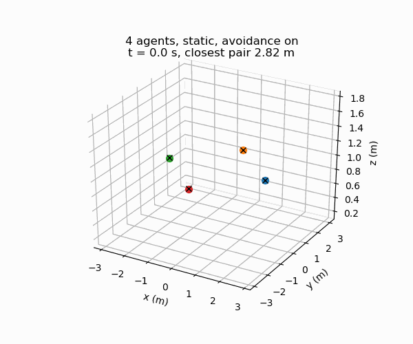
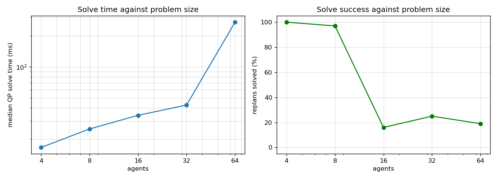

# centralmpc

Centralized model predictive control for multi-robot trajectory planning in 3D.

[](https://github.com/kaRpuri/centralmpc/actions/workflows/ci.yml)
[](https://www.python.org/)
[](LICENSE)




Four agents swapping positions through a shared point, with inter-agent
separation enabled. Generated by `centralmpc animate --config avoidance_demo`.

## How it works

### Agent model

Each agent `i` has a position and a velocity in 3D, and is commanded with an
acceleration:

$$
x_i = \begin{bmatrix} p_i \\ v_i \end{bmatrix} \in \mathbb{R}^6,
\qquad
u_i = a_i \in \mathbb{R}^3 .
$$

It is a double integrator, discretized with a zero order hold over a timestep
`dt`:

$$
x_i(k+1) = A\,x_i(k) + B\,u_i(k),
\qquad
A = \begin{bmatrix} I_3 & dt\,I_3 \\ 0 & I_3 \end{bmatrix},
\qquad
B = \begin{bmatrix} \tfrac{1}{2} dt^2 I_3 \\ dt\,I_3 \end{bmatrix} .
$$

This discretization is exact for an acceleration held constant across a step,
so a constant command from rest gives exactly $p = \tfrac{1}{2} a t^2$ with no
accumulated discretization error. `tests/test_dynamics.py` checks this.

### Joint problem

The `N` agent states and controls are stacked, which makes the dynamics block
diagonal:

$$
X(k) \in \mathbb{R}^{6N}, \quad U(k) \in \mathbb{R}^{3N}, \qquad
\mathbf{A} = I_N \otimes A, \quad \mathbf{B} = I_N \otimes B .
$$

Over a horizon of `H` intervals the controller minimizes tracking error and
control effort. The reference velocity is always zero, so the cost pulls each
agent towards its goal and asks it to stop there:

$$
J = \sum_{k=0}^{H-1} \sum_{i=1}^{N} \Big( Q_p \lVert p_i(k) - p_i^{\text{ref}}(k) \rVert^2 + Q_v \lVert v_i(k) \rVert^2 \Big) +
Q_T \sum_{i=1}^{N} \Big( Q_p \lVert p_i(H) - p_i^{\text{ref}}(H) \rVert^2 + Q_v \lVert v_i(H) \rVert^2 \Big) +
R \sum_{k=0}^{H-1} \lVert U(k) \rVert^2 .
$$

The terminal multiplier $Q_T$ scales both tracking weights at the last step.

### Constraints

$$
\begin{aligned}
X(0) &= x_{\text{meas}} & & \text{measured state} \\
X(k+1) &= \mathbf{A} X(k) + \mathbf{B} U(k), & & k = 0 \dots H-1 \\
p_{\min} &\le p_i(k) \le p_{\max}, & & k = 0 \dots H \\
-\alpha\, v_{\max} &\le v_i(k) \le \alpha\, v_{\max}, & & k = 0 \dots H \\
-a_{\max} &\le u_i(k) \le a_{\max}, & & k = 0 \dots H-1
\end{aligned}
$$

The velocity and acceleration bounds are per axis, not on the norm. The factor
$\alpha = 0.95$ keeps the planned velocity inside the simulator's own speed
clamp so the clamp is never the binding limit.

The cost is convex quadratic and every constraint is linear, so this is a QP.
It is solved with OSQP through CVXPY. The problem is built once; the measured
state and the reference enter as parameters, so each replan reuses the same
factorization and warm starts from the previous solution.

### Inter-agent separation

The constraints above couple the agents only through the shared cost. Nothing
in them keeps two agents apart, so the baseline formulation lets agents pass
through each other. The measured minimum separation without the separation
constraint is 0.0267 m on the default scenario.

Separation is available as an option, off by default. The Euclidean distance
constraint $\lVert p_i - p_j \rVert \ge d_{\min}$ is not convex, so it is
linearized into a half space about a reference trajectory $\hat{p}$:

$$
n_{ij}(k)^{\top} \big( p_i(k) - p_j(k) \big) \ge d_{\min} - s_{ij}(k),
\qquad
n_{ij}(k) = \frac{\hat{p}_i(k) - \hat{p}_j(k)}{\lVert \hat{p}_i(k) - \hat{p}_j(k) \rVert},
\qquad
s_{ij}(k) \ge 0 ,
$$

for every unordered pair and every $k = 1 \dots H$. Step 0 is skipped because
it is already fixed by the measured state. The normal $n_{ij}$ enters as a
parameter, so the constraint stays linear in the decision variables and the
problem stays a QP. The reference $\hat{p}$ is the previous solve's predicted
positions; on the first solve it is the current position held constant.

The slack $s_{ij}$ is penalized in the cost with a weight $w_s$:

$$
J_{\text{sep}} = w_s \sum_{i \lt j} \sum_{k=1}^{H} s_{ij}(k)^2 .
$$

The slack is not cosmetic. Because the normals come from the previous plan,
once two agents are already closer than $d_{\min}$ no reachable state satisfies
the half space within one timestep, and a hard constraint makes the QP
infeasible exactly when avoidance matters most. With the penalized slack the
QP stays feasible: on the default scenario the avoidance run solves 94 of 100
replans against 91 of 100 for the baseline, so turning separation on does not
cost solve reliability.

## Results

Measured on an AMD Ryzen 7 8840HS, Python 3.10.12, CVXPY 1.6.6, OSQP 1.0.4.
Every number below comes from running the code in this repository. Solve times
are per QP solve, one solve per replanning step.

### Separation constraint on and off

The same scenario and the same seed, with `avoidance_enabled` as the only
difference between `configs/default.json` and `configs/avoidance_demo.json`.
Four agents, horizon 30, 20 s simulated, 100 replans. Collision events are
counted at a 0.2 m radius.

| | avoidance off | avoidance on |
|---|---|---|
| minimum separation | 0.0267 m | 0.4145 m |
| collision events | 6 | 0 |
| mean goal error | 0.3742 m | 0.4849 m |
| replans solved | 91 / 100 | 94 / 100 |
| median solve time | 34.1 ms | 108.8 ms |
| 95th percentile solve time | 119.6 ms | 165.0 ms |

The constraint asks for 0.5 m and holds 0.4145 m. The gap is expected: the
half space is a first order approximation to the distance, and the slack is
penalized rather than forbidden. It removes every collision event on this
scenario at about three times the solve cost.

Reproduce with:

```bash
centralmpc run --config default --run 2
centralmpc run --config avoidance_demo --run 2
```

### Scaling

Agents from 4 to 64, horizon 16, 10 s simulated, 100 replans each, avoidance
off. These are the recorded scale configurations.

| agents | median solve | 95th percentile | replans solved | collision events |
|---|---|---|---|---|
| 4 | 16.7 ms | 30.8 ms | 100 / 100 | 1 |
| 8 | 25.1 ms | 87.6 ms | 97 / 100 | 4 |
| 16 | 34.0 ms | 313.3 ms | 16 / 100 | 9 |
| 32 | 42.7 ms | 644.5 ms | 25 / 100 | 41 |
| 64 | 269.1 ms | 1360.0 ms | 19 / 100 | 182 |



Solve time grows with problem size, as expected for a single joint QP. The
more interesting number is the second column from the right. Beyond 8 agents
most replans do not return a solution. The cause is the initial state
constraint: measurement noise can push the measured velocity outside the
$\alpha v_{\max}$ bound, and since $X(0)$ is pinned to the measured state, the
QP is then infeasible at step 0. The simulator coasts on a zero command and
brakes after three consecutive failures. This is a real limit of the
formulation, not a solver tuning problem, and it is why the collision counts
climb with agent count.

Reproduce with `bash scripts/run_scale_tests.sh`.

### Against a distributed baseline

The recorded nine scenario comparison against distributed DMPC is in
`results/numerical_comparison_summary.txt`. Mean goal error over the first 10 s
and collision events at a 0.2 m radius, averaged over three runs:

| scenario | centralized error | on-demand error | BVC error | centralized collisions | on-demand collisions | BVC collisions |
|---|---|---|---|---|---|---|
| 1 | 0.6703 m | 1.0812 m | 1.3141 m | 4.7 | 0.3 | 0.0 |
| 3 | 0.3921 m | 0.4820 m | 0.4711 m | 0.0 | 0.0 | 0.0 |
| 7 | 1.2723 m | 1.5248 m | 1.8750 m | 6.0 | 0.0 | 0.0 |
| 8 | 0.8381 m | 1.4328 m | 1.5171 m | 2.3 | 0.0 | 0.0 |
| 9 | 0.7237 m | 0.9057 m | 1.1694 m | 3.7 | 0.0 | 0.0 |

The joint QP tracks goals more closely than the distributed methods on every
scenario, and collides where they do not. That is the trade this repository
measures: the distributed methods carry an explicit collision term, the
baseline centralized formulation does not. The separation constraint described
above closes that gap on the default scenario.

Scoring the recorded runs with the current code reproduces these numbers
exactly, which is how the refactor was checked:

```bash
python scripts/compare_distributed.py --central-root experiments --scenarios 1 8 9
```

The distributed counterpart is
[SwarmSync](https://github.com/Shreyas0812/SwarmSync). Its run tree is not
part of this repository; pass it with `--distributed-root` to regenerate the
full comparison.

## Install

```bash
git clone https://github.com/kaRpuri/centralmpc.git
cd centralmpc
pip install -e ".[dev]"
```

Python 3.10 or 3.11.

## Usage

Simulate a scenario and write its trajectories, goals and summary:

```bash
centralmpc run --config default --run 2 --plots
```

Turn the separation constraint on for any scenario:

```bash
centralmpc run --config default --avoidance --min-separation 0.5
```

Measure solve time and solve success against agent count:

```bash
centralmpc scale --configs scale_4_agents scale_8_agents scale_16_agents --duration 10
```

Score a saved run directory and write its figures:

```bash
centralmpc analyze runs/default/run_2 --time-limit 10 --collision-radius 0.2
```

Render a run to an animated GIF:

```bash
centralmpc animate --config avoidance_demo --duration 8 --output assets/demo.gif
```

Every command accepts `--log-level` and prints a JSON summary. Run
`centralmpc <command> --help` for the full option list.

## Configuration

Scenarios are JSON files in `configs/`, loaded into the `ScenarioConfig`
dataclass. Unknown keys are rejected rather than ignored. The fourteen
scenario and scale configs were recovered from the `config.json` that each
recorded experiment saved next to its output, so they reproduce those runs.

```json
{
  "name": "default",
  "num_agents": 4,
  "horizon": 30,
  "dt": 0.01,
  "dt_plan": 0.2,
  "sim_duration": 20.0,
  "pos_min": [-5.0, -5.0, 0.0],
  "pos_max": [5.0, 5.0, 3.0],
  "vel_max": 1.5,
  "acc_max": 3.0,
  "Q_pos": 50.0,
  "Q_vel": 1.0,
  "R": 0.1,
  "Q_terminal": 20.0,
  "motion_type": "static",
  "collision_radius": 0.2,
  "avoidance_enabled": false,
  "min_separation": 0.5,
  "separation_penalty": 10000.0,
  "seed_base": 42
}
```

`motion_type` selects how the goals move: `static`, `circular`,
`translating` or `circular_translating`. `seed_base` seeds the measurement
noise, with run `r` using `seed_base + r`, which is what makes a run
reproducible. The command line can override the duration, horizon, avoidance
flag and separation distance without editing a file.

## Repository structure

```
centralmpc/
├── src/centralmpc/
│   ├── dynamics.py        double integrator model and discretization
│   ├── controller.py      CentralMPC: builds the QP, solves, warm starts
│   ├── constraints.py     bounds and the linearized separation half space
│   ├── goals.py           static, circular, translating, combined goal motion
│   ├── scenario.py        config dataclasses and the closed loop simulation
│   ├── cli.py             run, scale, analyze, animate
│   └── analysis/
│       ├── metrics.py     tracking error, collision events, separation
│       ├── plots.py       figures and the 3D animation
│       └── compare.py     comparison against the distributed baseline
├── configs/               scenario files, one per recorded experiment
├── scripts/               thin wrappers over the CLI
├── tests/                 pytest suite
├── assets/                demo.gif and scaling.png
├── results/               recorded comparison tables and figures
└── results_central/       recorded runs of the four goal motion patterns
```

Bulk simulation output under `experiments/` and `runs/` is not tracked.
Regenerate it with `centralmpc run` and `centralmpc scale`.

## Testing

```bash
ruff check .
ruff format --check .
pytest
```

56 tests covering the dynamics against the analytic double integrator, each
goal pattern against its closed form, the constraint builders, controller
feasibility and bound compliance, scenario loading and reproducibility, and an
end to end path through the CLI. CI runs all three on Python 3.10 and 3.11.

## Acknowledgments

The scenario set, the noise parameters and the trajectory file format follow
the distributed DMPC work this controller was built to compare against, which
is available as [SwarmSync](https://github.com/Shreyas0812/SwarmSync).

## License

MIT, see [LICENSE](LICENSE).
